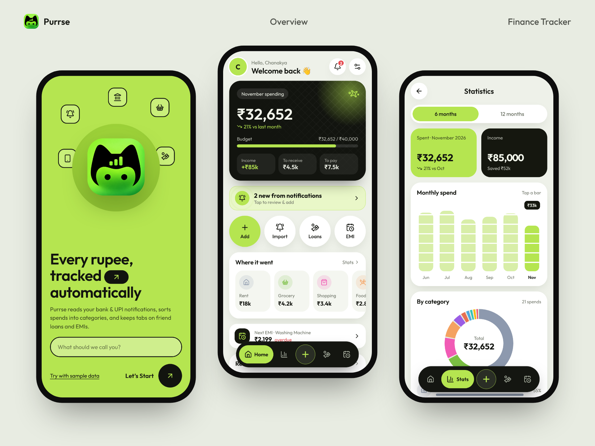

# Purrse – personal finance tracker

A mobile-first React app (installable PWA) that tracks spending, money lent to and borrowed from friends, and EMIs. Everything stays on the device (IndexedDB).




## Features
- **Notification capture**: parses bank SMS, UPI and wallet notifications (amount, debit or credit, merchant, date, bank, last 4 digits of the account) and assigns a category automatically. Captured items wait in an inbox for review, or are added straight away if **Auto-add** is on.
- **Categories**: Grocery, Food, Recharge, Bills, Transport, Fuel, Shopping, Entertainment, Health, Rent, EMI, Education, Travel, Transfer, plus income categories. You can recategorise any transaction.
- **Monthly totals**: the home screen shows this month's spend against your budget. Stats has a 6 or 12 month bar chart, a category donut, and a table of every month's spent, income and net.
- **Friend loans (orange theme)**: summary of money you'll get back and money you owe, plus a table of Friend, Type, Balance and Status. You can record part repayments, set due dates, mark a loan settled and see its history.
- **EMI tracker**: attach a photo to each EMI (bill, product, agreement), see progress rings and the next due date or overdue status, and tap any month in the schedule to mark it paid. Each paid month is logged as an EMI expense.
- **Dark mode**: Light, Dark or Auto (follows the system).
- **Animations**: spring transitions between screens, sheets you can drag down to close, animated counters, bars, rings and donut, and the accent colour fades smoothly when the theme changes.

## Run
```bash
npm install
npm run dev      # http://localhost:5173
npm run build    # production build in dist/
```

## How notifications get in
| Where | How |
|---|---|
| Android wrapper (native) | A `NotificationListenerService` forwards each notification's text with `window.PurrseBridge.push(text, appName)`, or by dispatching a `purrse:notification` event with `{ text, app }`. |
| Installed PWA on Android | **Share → Purrse** from any SMS or notification (Web Share Target). |
| Any browser | **Import** sheet: paste one or more messages, one per line. |

The parser is in `src/parser.js` and the keyword rules for categories are in `src/categories.js`.
