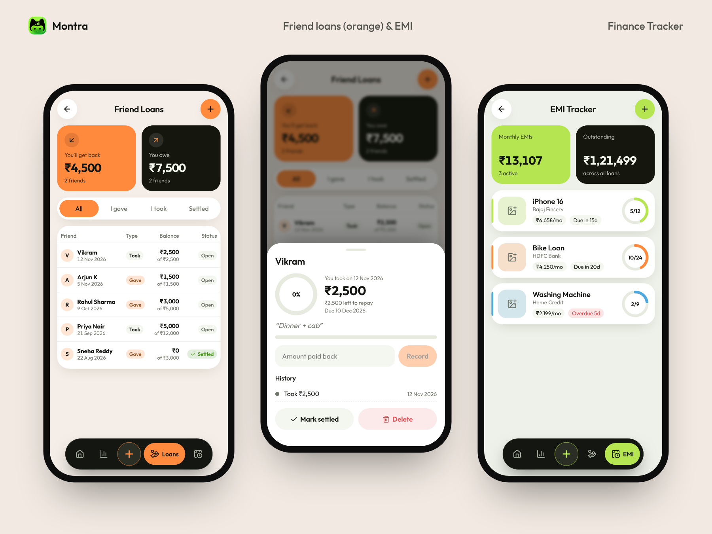
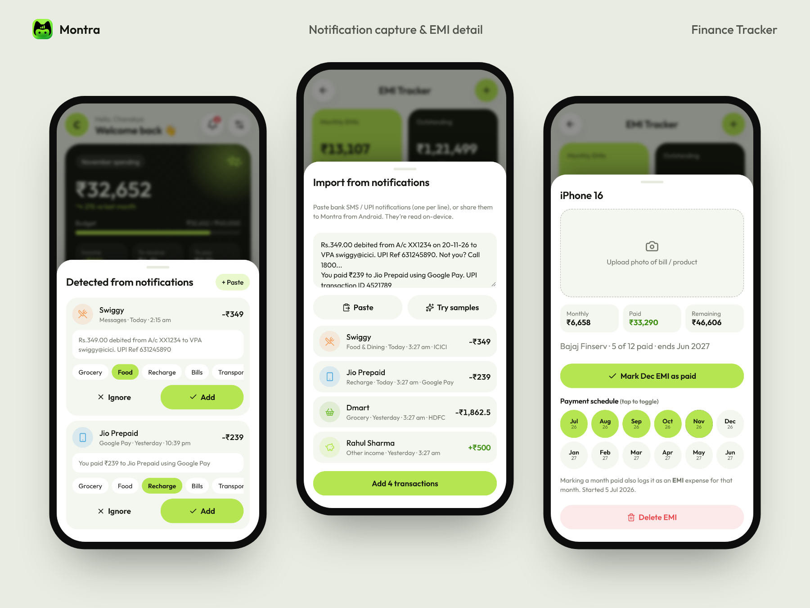
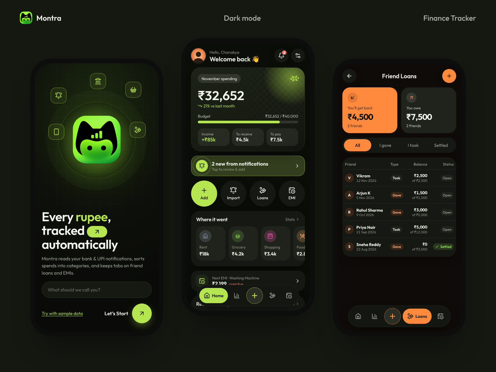
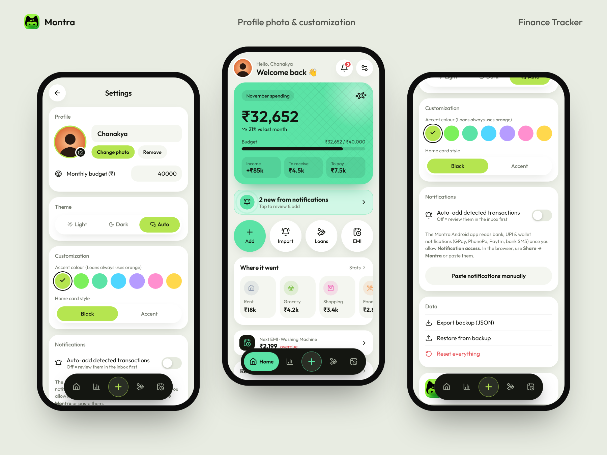

# Montra – personal finance tracker

A mobile-first React app (installable PWA) that tracks spending, money lent to and borrowed from friends, and EMIs. Everything stays on the device (IndexedDB).







## Features
- **Notification capture**: parses bank SMS, UPI and wallet notifications (amount, debit or credit, merchant, date, bank, last 4 digits of the account) and assigns a category automatically. Captured items wait in an inbox for review, or are added straight away if **Auto-add** is on.
- **Categories**: Grocery, Food, Recharge, Bills, Transport, Fuel, Shopping, Entertainment, Health, Rent, EMI, Education, Travel, Transfer, plus income categories. You can recategorise any transaction.
- **Monthly totals**: the home screen shows this month's spend against your budget. Stats has a 6 or 12 month bar chart, a category donut, and a table of every month's spent, income and net.
- **Friend loans (orange theme)**: summary of money you'll get back and money you owe, plus a table of Friend, Type, Balance and Status. You can record part repayments, set due dates, mark a loan settled and see its history.
- **EMI tracker**: attach a photo to each EMI (bill, product, agreement), see progress rings and the next due date or overdue status, and tap any month in the schedule to mark it paid. Each paid month is logged as an EMI expense.
- **Dark mode**: Light, Dark or Auto (follows the system).
- **Profile & customization**: profile photo, name, budget, 7 accent colours, and a black or accent-coloured home card.
- **Animations**: spring transitions between screens, sheets you can drag down to close, animated counters, bars, rings and donut, and the accent colour fades smoothly when the theme changes.

## Run
```bash
npm install
npm run dev      # http://localhost:5173
npm run build    # production build in dist/
```

## Android app
A native Android app (Capacitor) lives in `android/`. It includes a `NotificationListenerService` (`MontraNotificationListener.java`) that keeps only notifications that look like money movements, such as bank SMS, UPI and card alerts. It queues them while the app is closed and sends them live while it's open.

```bash
npm run build && npx cap sync android
cd android && ./gradlew assembleDebug   # → android/app/build/outputs/apk/debug/app-debug.apk
```
Every push also builds the APK in GitHub Actions (artifact `montra-debug-apk`).

After installing, open Montra and tap **Turn on auto-tracking**, then allow **Notification access** for Montra. On Android 13 and later, if the toggle is greyed out, first go to *App info → ⋮ → Allow restricted settings*.

## How notifications get in
| Where | How |
|---|---|
| Android wrapper (native) | Reads notifications automatically once Notification access is granted (`src/native.js`). |
| Installed PWA on Android | **Share → Montra** from any SMS or notification (Web Share Target). |
| Any browser | **Import** sheet: paste one or more messages, one per line. |

The parser is in `src/parser.js` and the keyword rules for categories are in `src/categories.js`.
